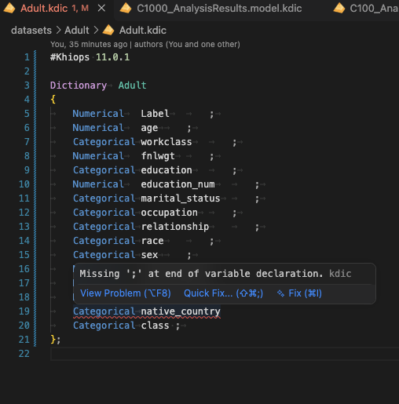

# Khiops Dictionary for VS Code

Language support for Khiops dictionary files (`.kdic`). Edit dictionary files with syntax highlighting, completions, hover documentation, snippets, and diagnostics directly in VS Code.

The extension provides fast built-in structural checks. When a Khiops binary is available, it can also run the native Khiops parser for authoritative semantic validation.

Edit `.kdic` files with syntax highlighting and receive diagnostics directly in the editor as you work.

## Features

- Syntax highlighting for dictionary declarations, types, derivations, metadata, comments, strings, and numbers
- Completions for keywords, types, dictionary names, derivation rules, the variables an operand can name (in the right dictionary, with `.` for the scope above), `#Missing` for numerical operands, and date and time format metadata keys
- Hover documentation for keywords, types, and derivation rules
- Snippets for common dictionary declarations and table relationships
- Built-in diagnostics for common structural and type errors
- Optional native Khiops diagnostics on save or auto-save
- Create a Khiops dictionary from a data file, with or without a header
- Support for single-table and multi-table dictionary files

## Quick Start

1. Install **Khiops Dictionary (.kdic)** from the VS Code Marketplace.
2. Open a `.kdic` file.
3. Start editing. Syntax highlighting, completions, hover documentation, and built-in diagnostics are available immediately.
4. Install Khiops and configure `kdic.khiopsPath` if you also want native Khiops validation.

The extension does not require a Khiops installation for syntax support or built-in validation. If no Khiops binary is found, the extension continues to provide its built-in diagnostics.

## Create a Dictionary from a Data File

With Khiops installed, choose **Create Khiops Dictionary from This File** from the Explorer file context menu, an editor tab's context menu, or the Command Palette. The palette uses the active file, or prompts for a file when no editor is active. Choose whether the first line contains column names or data.

The source must be a local file on the extension host, not a `.kdic`. The `.kdic` is created next to it, replacing the source's final extension. You are asked before an existing dictionary is replaced. Errors are shown in a notification; for a failed Khiops run, details are available in the **Khiops** output channel. An existing dictionary is preserved when creation fails. Paths containing line breaks cannot be used. The command uses `kdic.khiopsPath`, or the automatic locations below when it is empty; it is available even when native validation is disabled.

## Native Khiops Validation

Native validation is enabled by default. Configure the executable path in VS Code settings when it is not discovered automatically:

```json
{
  "kdic.khiopsPath": "/Applications/Khiops.app/Contents/Resources/bin/MODL"
}
```

The setting accepts either the executable path or its containing directory. The executable names are:

| Platform | Executable     |
| -------- | -------------- |
| macOS    | `MODL`         |
| Linux    | `MODL_openmpi` |
| Windows  | `MODL.exe`     |

Automatic discovery uses the following paths:

1. The explicit `kdic.khiopsPath` setting
2. `/Applications/Khiops.app/Contents/Resources/bin/MODL` on macOS
3. `/usr/bin/MODL_openmpi` on Linux
4. `%KHIOPS_HOME%\\bin\\MODL.exe` on Windows

Built-in diagnostics are produced while editing and Khiops runs on an eligible save only when the built-in validator reports no errors. Built-in warnings do not prevent the native run.

### Runtime Version Check

Before native validation or dictionary creation first uses an executable, the extension runs it with `-v` and compares its full version with the documentation reference listed under [Requirements](#requirements). Any difference, including a newer release or a prerelease/build suffix, triggers a non-blocking warning, not a declaration of incompatibility. **Show Output** reveals both versions and the executable path in the **Khiops** output channel. Built-in checks remain unchanged.

Both features share one check per executable path per extension activation, with a five-second timeout. Detection failures also warn and provide output details, but the operation still proceeds. No new setting is needed. Restart the extension to check again after replacing an executable in place.

### Settings

| Setting                       | Default | Purpose                                           |
| ----------------------------- | ------- | ------------------------------------------------- |
| `kdic.enableKhiopsValidation` | `true`  | Enable native Khiops validation                   |
| `kdic.runKhiopsOnAutoSave`    | `true`  | Run native validation after auto-save events      |
| `kdic.enableDebugTraces`      | `false` | Write detailed Khiops traces to the Output panel  |
| `kdic.khiopsPath`             | empty   | Set the Khiops executable or containing directory |

For large dictionary files, set `kdic.runKhiopsOnAutoSave` to `false` and use save-triggered validation instead.

## Built-in Diagnostics

The built-in validator checks common problems while you edit, including:

- Missing or misplaced semicolons
- Unclosed, unmatched, or incorrectly nested braces, parentheses, and external-key brackets
- Malformed metadata, variable names, or derivation constants
- Invalid dictionary headers and variable blocks
- Key fields that are not `Categorical`
- Key fields missing from the dictionary
- Unknown `Table(...)` and `Entity(...)` dictionary references
- Derivation return-type and argument-type mismatches, for variables, constants and nested calls
- Undeclared derivation arguments
- Invalid derived key fields
- Dictionary and variable names longer than 128 characters
- Date and time format metadata (`DateFormat`, `TimeFormat`, `TimestampFormat`, `TimestampTZFormat`) on a variable of another type, without a string value, or with a format Khiops does not know

Built-in validation is intentionally structural and best-effort. Arguments are checked in the dictionary they are resolved in, including the dictionary of the table for the secondary operands of table and entity rules; operands whose scope is not known are not type-checked. The scope operator `.` is followed up the enclosing scopes. The native Khiops parser remains authoritative for joins and complex block contents.

VS Code turns every carriage return of a file into a line break in the editor, whereas Khiops only treats `\n` as one: an isolated `\r` inside quoted text is legal in a `.kdic` file. For such a file the editor text no longer matches the file, so the built-in diagnostics are turned off for it and the native Khiops check is the one to rely on. Saving rewrites the file with ordinary line breaks, and built-in diagnostics resume.

## Example in VS Code



Use `Ctrl+Space` or `Cmd+Space` to request completions. Hover over a keyword, type, or derivation rule to see its documentation.

## Troubleshooting

### Native diagnostics do not appear

- Confirm that `kdic.enableKhiopsValidation` is enabled.
- Set `kdic.khiopsPath` to the executable itself when automatic discovery does not find it.
- Check the **Khiops** output channel when `kdic.enableDebugTraces` is enabled.

## Requirements

- VS Code 1.79 or later
- Khiops is optional for built-in language support and required only for native validation
- The built-in checks follow the documentation of **Khiops 11.0.2** published on khiops.org, plus the instance-building rules (`BuildEntity`, `BuildTableView`, …) of the next Khiops release, which Khiops 11.0.2 does not know. Native validation uses the Khiops you installed, whatever its version.

## Links

- [Khiops dictionary file documentation](https://khiops.org/api-docs/kdic/dictionary-files/)
- [Kdic VS Code extension repository](https://github.com/KhiopsML/kdic-vscode-extension)
- [Report an issue](https://github.com/KhiopsML/kdic-vscode-extension/issues)
