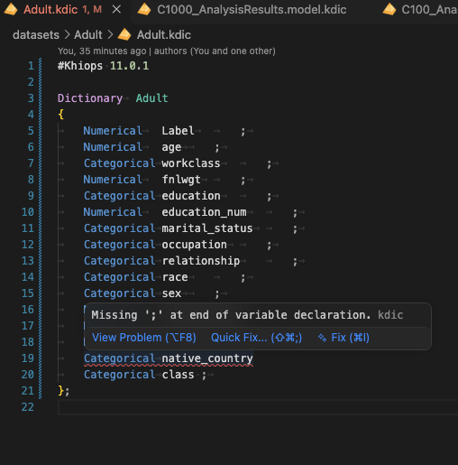

# Khiops Dictionary for VS Code

Language support for Khiops dictionary files (`.kdic`). Edit dictionary files with syntax highlighting, completions, hover documentation, snippets, and diagnostics directly in VS Code.

The extension provides fast built-in structural checks. When a Khiops binary is available, it can also run the native Khiops parser for authoritative semantic validation.

Edit `.kdic` files with syntax highlighting and receive diagnostics directly in the editor as you work.

## Features

- Syntax highlighting for dictionary declarations, types, derivations, metadata, comments, strings, and numbers
- Completions for keywords, types, dictionary names, and derivation rules
- Hover documentation for keywords, types, and derivation rules
- Snippets for common dictionary declarations and table relationships
- Built-in diagnostics for common structural and type errors
- Optional native Khiops diagnostics on save or auto-save
- Support for single-table and multi-table dictionary files

## Quick Start

1. Install **Khiops Dictionary (.kdic)** from the VS Code Marketplace.
2. Open a `.kdic` file.
3. Start editing. Syntax highlighting, completions, hover documentation, and built-in diagnostics are available immediately.
4. Install Khiops and configure `kdic.khiopsPath` if you also want native Khiops validation.

The extension does not require a Khiops installation for syntax support or built-in validation. If no Khiops binary is found, the extension continues to provide its built-in diagnostics.

## Native Khiops Validation

Native validation is enabled by default. Configure the executable path in VS Code settings when it is not discovered automatically:

```json
{
  "kdic.khiopsPath": "/Applications/Khiops.app/Contents/Resources/bin/MODL"
}
```

The setting accepts either the executable path or its containing directory. The executable names are:

| Platform | Executable     |
| -------- | -------------- |
| macOS    | `MODL`         |
| Linux    | `MODL_openmpi` |
| Windows  | `MODL.exe`     |

Automatic discovery uses the following paths:

1. The explicit `kdic.khiopsPath` setting
2. `/Applications/Khiops.app/Contents/Resources/bin/MODL` on macOS
3. `/usr/bin/MODL_openmpi` on Linux
4. `%KHIOPS_HOME%\\bin\\MODL.exe` on Windows

### Settings

| Setting                       | Default | Purpose                                           |
| ----------------------------- | ------- | ------------------------------------------------- |
| `kdic.enableKhiopsValidation` | `true`  | Enable native Khiops validation                   |
| `kdic.diagnosticSource`       | `both`  | Show `khiops`, `extension`, or `both` diagnostics |
| `kdic.runKhiopsOnAutoSave`    | `true`  | Run native validation after auto-save events      |
| `kdic.enableDebugTraces`      | `false` | Write detailed Khiops traces to the Output panel  |
| `kdic.khiopsPath`             | empty   | Set the Khiops executable or containing directory |

For large dictionary files, set `kdic.runKhiopsOnAutoSave` to `false` and use save-triggered validation instead.

## Built-in Diagnostics

The built-in validator checks common problems while you edit, including:

- Missing or misplaced semicolons
- Unclosed or unmatched braces
- Invalid dictionary headers and variable blocks
- Key fields that are not `Categorical`
- Unknown `Table(...)` and `Entity(...)` dictionary references
- Simple derivation return-type and argument-type mismatches
- Undeclared derivation arguments
- Invalid derived key fields
- Dictionary and variable names longer than 128 characters

Built-in validation is intentionally structural and best-effort. The native Khiops parser remains authoritative for nested derivations, secondary-table scopes, joins, and complex block contents.

## Example in VS Code



Use `Ctrl+Space` or `Cmd+Space` to request completions. Hover over a keyword, type, or derivation rule to see its documentation.

## Troubleshooting

### Native diagnostics do not appear

- Confirm that `kdic.enableKhiopsValidation` is enabled.
- Set `kdic.khiopsPath` to the executable itself when automatic discovery does not find it.
- Check the **Khiops** output channel when `kdic.enableDebugTraces` is enabled.
- Use `kdic.diagnosticSource: "khiops"` to display only native diagnostics.

### Too many diagnostics appear

Set `kdic.diagnosticSource` to `extension` or `khiops` to use one diagnostic source instead of both.

## Requirements

- VS Code 1.79 or later
- Khiops is optional for built-in language support and required only for native validation

## Links

- [Khiops dictionary file documentation](https://khiops.org/api-docs/kdic/dictionary-files/)
- [Kdic VS Code extension repository](https://github.com/KhiopsML/kdic-vscode-extension)
- [Report an issue](https://github.com/KhiopsML/kdic-vscode-extension/issues)
